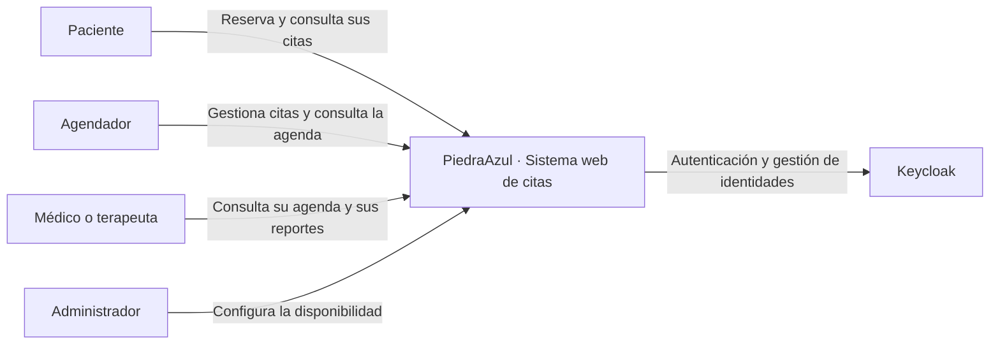

# PiedraAzul · Diagrama de contexto C4

PiedraAzul es un sistema web para gestionar citas médicas, consultar la agenda y configurar la disponibilidad de los profesionales.

El médico consulta la cantidad de citas por mes para un año elegido y la asistencia por estado para una semana. Ambos reportes usan el perfil del médico autenticado.