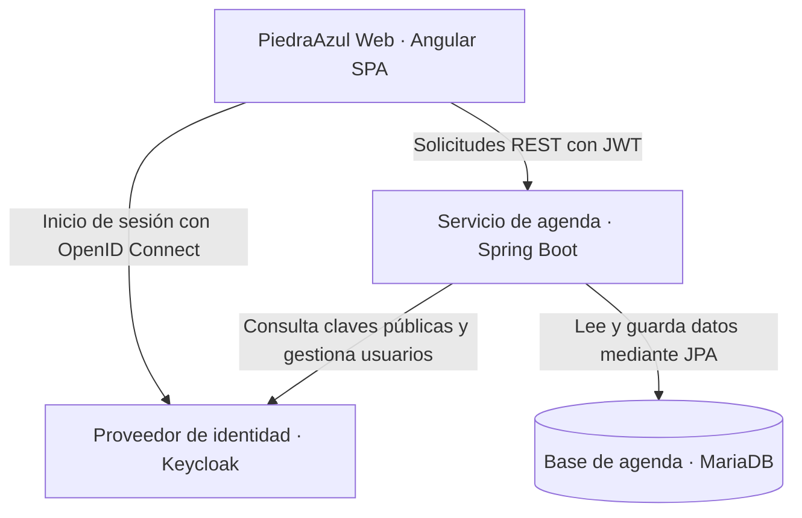
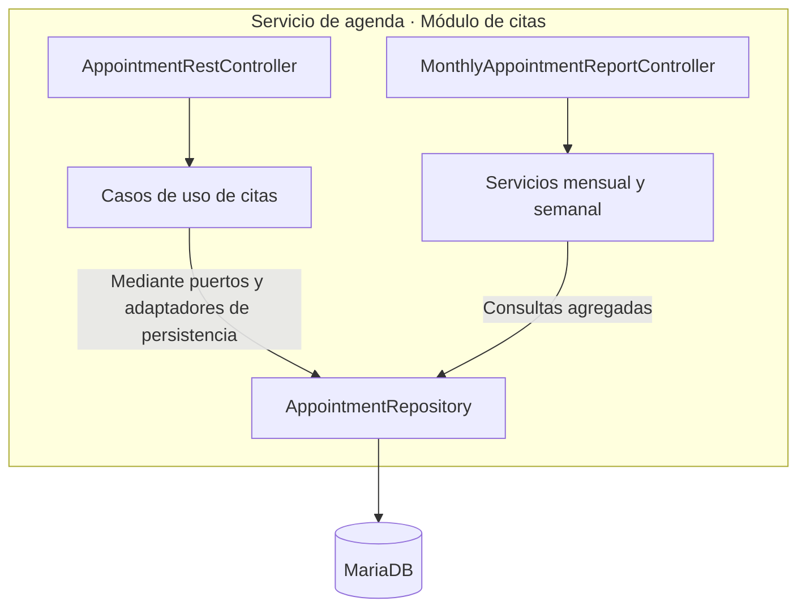

# PiedraAzul · Estructura C4

## Nivel 2 · Contenedores

Angular presenta los portales de paciente, agendador, médico y administrador.
Spring Boot concentra la lógica del negocio en un monolito modular.
MariaDB almacena los datos de la agenda y Keycloak administra las identidades y los roles.

## Nivel 3 · Componentes de citas y reportes

El controlador de reportes expone las rutas mensual y semanal. Identifica al
médico activo mediante la sesión autenticada y entrega su identificador al
servicio correspondiente.