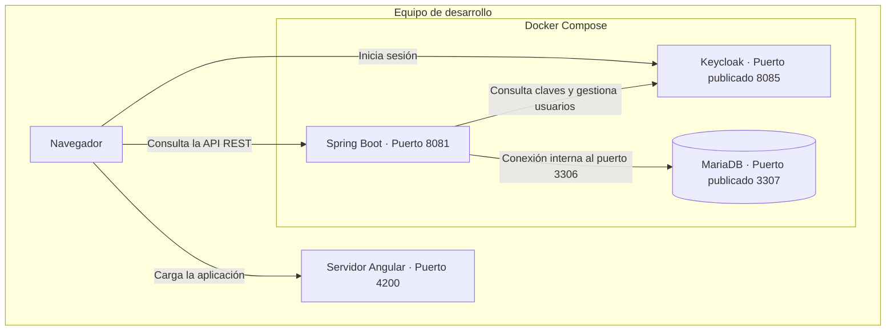

# PiedraAzul · Despliegue local y vistas 4+1

## Despliegue local

En desarrollo, Angular se inicia con `npm start`. Docker Compose ejecuta
Spring Boot, Keycloak y MariaDB. El diagrama representa el entorno local.
El diagrama de nube debe incorporar la infraestructura y el flujo de
despliegue que valide el equipo.

## Correspondencia con las vistas 4+1

| Vista | Evidencia en el repositorio |
|---|---|
| Lógica | El [UML de agenda](uml-agenda.md) muestra las entidades del negocio y sus relaciones. |
| Desarrollo | La [estructura C4](c4-structure.md) muestra la separación entre Angular y Spring Boot, y los componentes de citas y reportes. |
| Procesos | La [secuencia UML](uml-agenda.md) muestra cómo se ejecutan las consultas mensual y semanal en tiempo de ejecución. |
| Física | El diagrama de despliegue local muestra el navegador, el servidor Angular y los servicios de Docker Compose. |
| Escenarios (+1) | El [contexto C4](c4-context.md) identifica los actores. El escenario de estadísticas se comprueba seleccionando un periodo con una cita conocida y verificando los totales en el portal médico. |