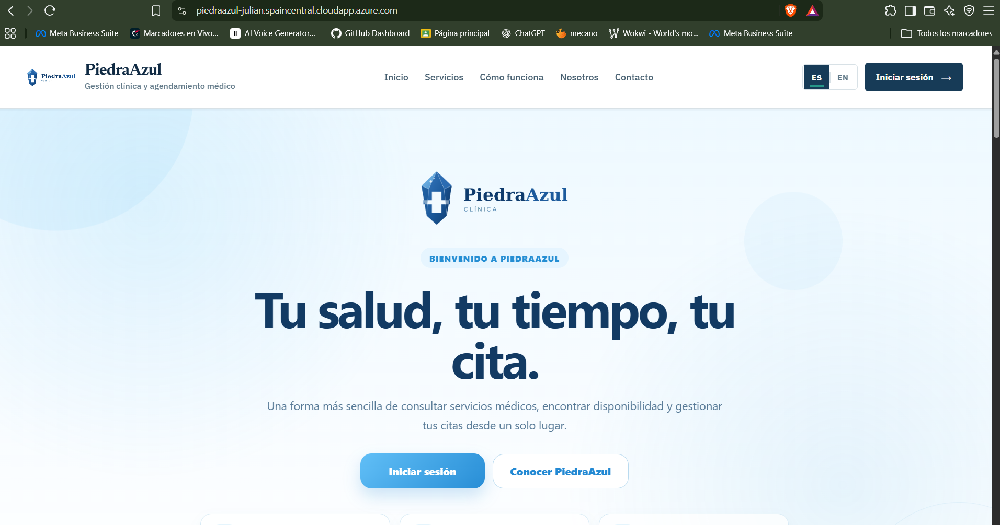
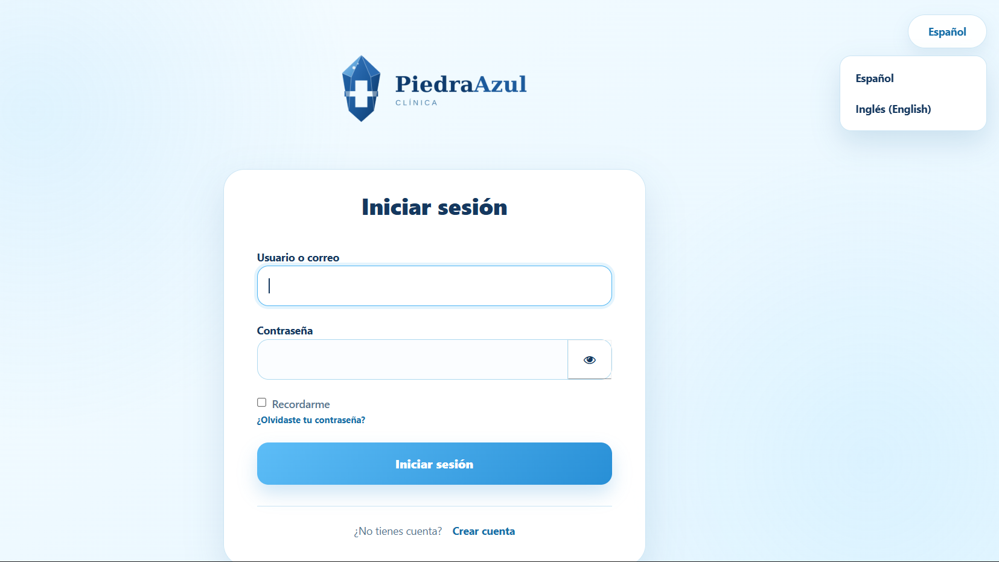
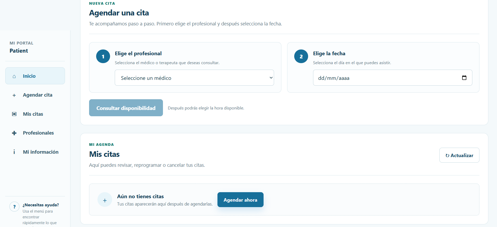
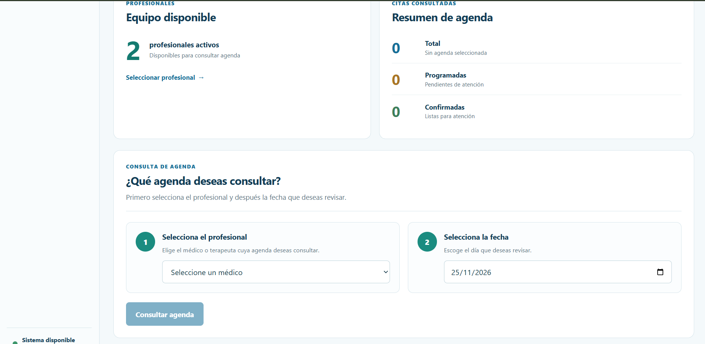
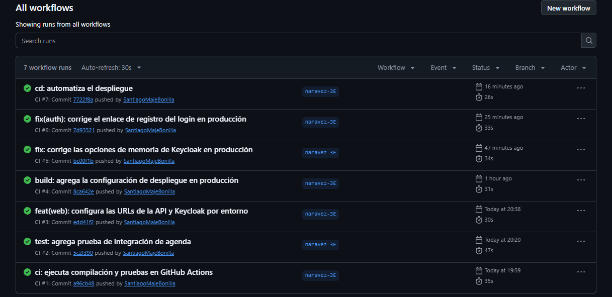

# Entorno publicado de PiedraAzul

**URL pública:** https://piedraazul-julian.spaincentral.cloudapp.azure.com

La aplicación completa (frontend, API, Keycloak y base de datos) está desplegada en una máquina virtual de Azure y se actualiza automáticamente cuando se fusionan cambios en `main`.

## Arquitectura del despliegue

```text
Navegador ──HTTPS──> Caddy (80/443, certificado Let's Encrypt)
                       ├── /api/*  ──> agenda-service (Spring Boot, 8081)
                       ├── /auth/* ──> Keycloak 25 (8080)
                       └── /*      ──> web (Angular servido por nginx, 80)

agenda-service ──> MariaDB 11.4 (red interna)
agenda-service ──> Keycloak (validación de JWT y administración de usuarios)
```

- Todos los servicios se publican bajo **un solo dominio**, por lo que el navegador no hace peticiones entre orígenes (sin problemas de CORS).
- **Solo Caddy expone puertos** (80 y 443). MariaDB, Keycloak, el backend y el frontend quedan en la red interna de Docker.
- Caddy obtiene y renueva automáticamente el certificado HTTPS. HTTPS es obligatorio porque `keycloak-js` requiere un contexto seguro para el login.

| Elemento | Valor |
|---|---|
| Proveedor | Microsoft Azure (suscripción Azure for Students) |
| Región | Spain Central |
| Máquina virtual | Standard B2ls v2 (2 vCPU, 4 GiB de RAM) + 4 GiB de swap |
| Sistema operativo | Ubuntu Server 24.04 LTS |
| Contenedores | Docker 29 y Docker Compose v2 |
| Dominio | `piedraazul-julian.spaincentral.cloudapp.azure.com` (etiqueta DNS de Azure) |

## Archivos del despliegue

| Archivo | Función |
|---|---|
| `docker-compose.prod.yml` | Define los cinco servicios de producción |
| `deploy/Caddyfile` | Proxy inverso, rutas y HTTPS automático |
| `piedraazul-web/Dockerfile` y `nginx.conf` | Compila Angular en modo producción y lo sirve con nginx |
| `piedraazul-web/src/environments/` | URLs de la API y de Keycloak según el entorno (local o producción) |
| `.env.example` | Plantilla de variables. El `.env` real solo existe en el servidor |
| `.github/workflows/ci.yml` | Integración continua |
| `.github/workflows/deploy.yml` | Despliegue continuo |

## Integración continua (CI)

`.github/workflows/ci.yml` se ejecuta en cada push y en cada pull request hacia `main`:

- **Backend:** Java 17 y `mvn verify`, que compila y ejecuta todas las pruebas, incluida la prueba de integración `AgendaIntegrationTest` (API, seguridad y persistencia).
- **Frontend:** Node 22, `npm ci`, build de producción (`ng build --configuration production`) y pruebas (`ng test`).

## Despliegue continuo (CD)

`.github/workflows/deploy.yml` se ejecuta cuando el CI termina con éxito sobre `main` (también se puede lanzar manualmente):

1. Se conecta por SSH al servidor con una llave exclusiva para GitHub Actions.
2. Actualiza el código a la última versión de `main`.
3. Reconstruye y reinicia los contenedores con `docker compose -f docker-compose.prod.yml --env-file .env up -d --build`.
4. Verifica que `https://piedraazul-julian.spaincentral.cloudapp.azure.com/api/agenda/health` responda. Si no responde en 5 minutos, el despliegue falla.

Secretos del repositorio usados por el CD: `DEPLOY_HOST`, `DEPLOY_USER` y `DEPLOY_SSH_KEY`.

## Primer despliegue manual

```bash
git clone https://github.com/bCharry15/Piedrazul-Medical-Web-Application.git ~/piedraazul
cd ~/piedraazul
cp .env.example .env          # y se reemplazan las contraseñas por valores aleatorios
chmod 600 .env
docker compose -f docker-compose.prod.yml --env-file .env up -d --build
```

## Verificación desde la URL pública

| Prueba | Resultado |
|---|---|
| Página de inicio por HTTPS | Carga correctamente con certificado válido |
| `GET /api/agenda/health` | HTTP 200 |
| Login con Keycloak como paciente | Inicia sesión y muestra "Mis citas" y los médicos disponibles |
| Login como agendador | Inicia sesión y muestra la agenda del médico |
| Enlace "Crear cuenta" del login | Abre el formulario de registro de PiedraAzul |











## Operación

```bash
cd ~/piedraazul
docker compose -f docker-compose.prod.yml ps                 # estado de los servicios
docker compose -f docker-compose.prod.yml logs -f keycloak   # registros de un servicio
docker compose -f docker-compose.prod.yml restart keycloak   # reiniciar un servicio
```

Para ahorrar crédito de Azure, la máquina virtual puede detenerse desde el portal (**Detener**) cuando no se use y encenderse antes de la demostración; la dirección y los datos se conservan.

## Limitaciones conocidas

- Keycloak se ejecuta en modo `start-dev` con su base de datos interna, adecuado para el entorno académico pero no para un sistema real en producción.
- El dominio es el que asigna Azure; un dominio propio requeriría comprarlo y apuntarlo a la IP de la máquina.
- El correo de notificaciones está deshabilitado (`NOTIFICATION_MAIL_ENABLED=false`).
